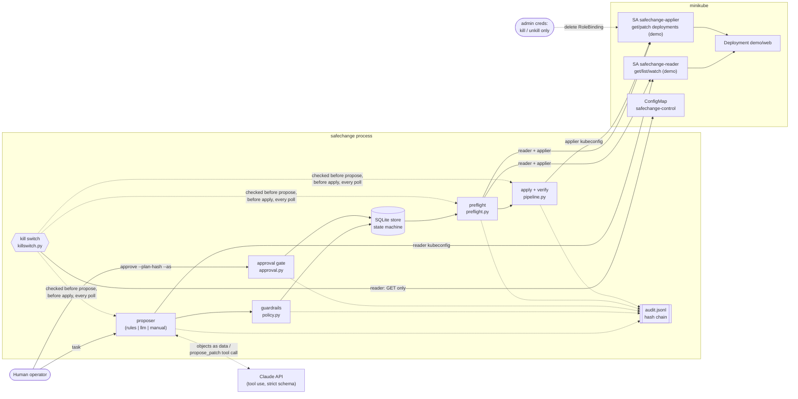
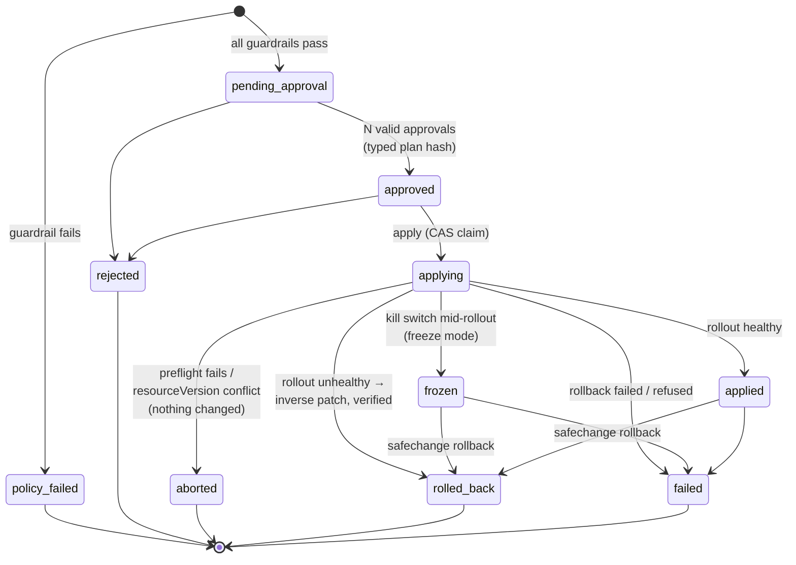

# safechange

An AI agent that proposes changes to Kubernetes manifests but **cannot apply anything**
until the change has passed policy guardrails, a human approval gate and a rollback
readiness check. If the rollout goes bad it rolls itself back. A two-layer kill switch
stops it, and a hash-chained audit log records every step.

Targets a local minikube cluster. Python 3.11+. Runtime dependency: PyYAML
(`anthropic` is optional, only for the LLM proposer).

---

## The problem

Letting an LLM change production infrastructure is attractive (natural-language ops,
faster toil) and dangerous (hallucinated fields, prompt injection, over-broad
credentials, no undo). Most "agent" demos hand the model a kubeconfig and hope for the
best. safechange takes the opposite approach. The model is an **untrusted proposer**.
Everything that makes a change safe is ordinary, deterministic, tested code that the
model cannot reach:

| Concern | Mechanism |
|---|---|
| Least privilege | Separate read-only and patch-only ServiceAccounts. The proposer only ever receives the reader. |
| Policy | 13 guardrails from YAML: path allowlist, replica bounds, registries, no `:latest`, limits, no privilege, server dry-run |
| Human in the loop | Approver must type the plan hash, must not be the agent, must be on the list. Approvals expire. N-of-M supported. |
| Safe apply | Preflight re-checks everything. Drift detection, snapshot round-trip, proven rollback, `can-i`. Optimistic concurrency via a JSON-patch `test` on `resourceVersion`. |
| Undo | Rollout is verified. If it is unhealthy, the exact inverse patch is applied and the restored state is verified. |
| Stop | Soft kill switch (file / env / ConfigMap) plus a hard one (delete the applier RoleBinding) |
| Accountability | Append-only JSONL audit log with a sha256 hash chain and a tail anchor. `safechange audit verify` checks it. |

## Architecture



Modules (`src/safechange/`): `patch` (RFC 6902 apply/diff/normalize/hash), `policy`,
`approval`, `preflight`, `killswitch`, `audit`, `store`, `backends/` (`fake`, `kubectl`;
split into `ClusterReader` / `ClusterApplier` / `ClusterAdmin`), `proposer`, `pipeline`,
`cli`, `config`.

## State machine



Transitions are compare-and-set updates in SQLite (`UPDATE … WHERE status = ?`). An
edge that is not in `models.TRANSITIONS` is refused, so no stage can be skipped and two
concurrent `apply` runs cannot both claim a proposal.

## Quickstart (minikube)

```bash
make cluster   # minikube profile "safechange": namespaces, RBAC, nginx "web", control CM, kubeconfigs
make test      # 127 tests, fake backend, no cluster needed
make demo      # scripted end-to-end run of every scenario against minikube
make clean     # minikube delete -p safechange
```

`make demo-fake` runs the same script against the in-memory fake cluster.

Manual use:

```bash
alias sc=.venv/bin/safechange           # reads ./safechange.yaml
sc propose "scale web to 4"             # -> proposal id, diff, policy results, plan hash
sc show <id>                            # colored unified diff + policy results + approvals
sc approve <id> --plan-hash 1a2b3c4d --as alice
sc apply <id> --as alice                # preflight -> patch -> verify (-> auto rollback)
sc list | sc status | sc audit verify
sc kill [--hard] --as alice | sc unkill --as alice
sc rollback <id> --as alice             # for frozen/applied proposals
```

LLM proposer: `pip install -e '.[llm]'`, set `ANTHROPIC_API_KEY` (or `ant auth login`),
then run `sc propose --proposer llm "bump web to 3 replicas and set LOG_LEVEL=debug"`.

Rules grammar (offline): `scale <d> to <n>`, `set image <d>[/<c>]=`,
`set env <d>[/<c>] K=V`, `set label <d> k=v`, `set limits <d>[/<c>] cpu=… memory=…`.

## Demo output (real minikube, abridged)

```
== 1. Happy path: scale web 2 -> 4, approve, apply, healthy -> applied
$ safechange approve f392deb3cc --plan-hash ab8d9361 --as alice
alice approved f392deb3cc; status now approved (1/1; expires in 30 min)
Nothing has changed in the cluster yet. To apply, run:
  safechange apply f392deb3cc --as alice
$ safechange apply f392deb3cc --as alice
  rollout: Waiting for deployment "web" rollout to finish: 2 of 4 updated replicas are available...
  rollout: deployment "web" successfully rolled out
f392deb3cc: applied

== 2. Bad image: readiness never passes -> automatic rollback
$ safechange apply 79f8e32da8 --as bob
  rollout: Waiting for deployment "web" rollout to finish: 2 out of 4 new replicas have been updated...
  rolling back: unhealthy: timed out after 45s: ...
  rollout: deployment "web" successfully rolled out
79f8e32da8: rolled_back
  rolled back (...); before-state restored and healthy

== 3. Policy denials
  [FAIL] image_not_latest                 unpinned/latest images: ['nginx:latest']
  [FAIL] paths_allowlisted                denied paths: ['/spec/template/spec/containers/0/securityContext']
  [FAIL] no_privileged_or_host_access     violations: ['web: privileged']
  [FAIL] replica_change_pct               4 -> 10 = 150% (max 100%)

== 4. Approval gate
APPROVAL DENIED: self-approval blocked: the agent identity cannot approve its own proposals
APPROVAL DENIED: plan hash mismatch: you did not review this exact diff
APPROVAL DENIED: 'mallory' is not in the approvers list

== 5. Drift
$ kubectl -n demo scale deploy/web --replicas=3
$ safechange apply b2c7107c47 --as alice
  [FAIL] no_drift_since_proposal   live object drifted since proposal; changed paths: ['/spec/replicas']
b2c7107c47: aborted
  preflight failed: ['no_drift_since_proposal', 'snapshot_roundtrip']; nothing changed

== 6. Kill switch
REFUSED: kill switch engaged, refusing to propose: kill file present: ...; configmap ... killed=true
  [FAIL] kill_switch_disengaged ...                       -> aborted
6b. hard kill mid-rollout:
KILL: hard: deleted rolebinding demo/safechange-applier
5c5509accf: frozen
  hard layer: applier can-i patch: no
$ safechange unkill --as alice && safechange rollback 5c5509accf --as alice
5c5509accf: rolled_back

== 7. Audit trail
audit chain OK: 49 entries, hash-linked, head anchored
```

## Design decisions and trade-offs

- **The model proposes, code decides.** The LLM gets a read-only snapshot. It must answer
  through a single `propose_patch` tool with a strict JSON schema. Free text, multiple
  calls, unknown targets and refusals are all rejected. Current Claude models reject
  *forced* `tool_choice`, so the proposer uses `auto` with a strict tool and fails closed
  when no tool call comes back. Cluster objects are wrapped in a data block, and the
  system prompt tells the model they are data, not instructions. Even so, prompt
  injection is defended by the guardrails, not by the prompt (see
  `test_llm_malicious_proposal_stopped_by_guardrails`).
- **JSON Patch, not full manifests.** Small, path-scoped ops make the allowlist
  enforceable, the diff reviewable and the inverse exact. `diff(after, before)` produces
  the rollback, and preflight proves `apply(after, rollback) == before` before touching
  the cluster. A randomized round-trip test covers the diff/apply pair.
- **Plan hash = sha256(target + normalized before + after).** The approver types a prefix
  of the hash, which binds the approval to *this exact diff*. Preflight recomputes the
  hash, so a proposal edited in the DB after approval is aborted. Normalization strips
  `status`, `resourceVersion`, `managedFields`, `generation` and similar fields, so
  controller writes are not counted as drift.
- **Two drift defenses.** (1) Preflight compares the normalized live object to `before`.
  This catches semantic drift, such as a human `kubectl scale`. (2) The patch starts with
  `{"op":"test","path":"/metadata/resourceVersion"}`, which closes the race between
  preflight and patch. The API server rejects the whole patch atomically.
- **Fail closed everywhere.** Every check runs inside a wrapper that turns exceptions into
  failures. An unreadable kill-switch ConfigMap counts as *engaged*. A missing applier
  makes the dry-run fail. If an apply error leaves the live state ambiguous, the proposal
  goes to `failed` and needs investigation; if the live state is unchanged it goes to
  `aborted`.
- **Rollback refuses to clobber.** Before rolling back, safechange checks that the live
  object still equals `after`. If someone else changed it meanwhile, it does *not* blindly
  overwrite. It marks the proposal `failed` and points at the snapshot.
- **Freeze is the default kill behavior.** Freeze leaves the cluster exactly as it is and
  hands the decision to a human. It is also the only option that still works under the
  hard kill, because a rollback needs write access.
- **Preflight runs every check.** It does not stop at the first failure, so the operator
  sees the whole picture (the drift demo shows two failures).
- **No `kubectl` in the proposer path, no admin creds in the agent path.** The two agent
  kubeconfigs each hold exactly one ServiceAccount token. Admin credentials are used only
  by `kill`/`unkill`/`status`. The fake backend enforces the same split: calling an
  applier method on the reader view raises.

## Limitations

- **`--as` is self-asserted.** On a local CLI anyone can type `--as alice`. Separation of
  duties is enforced *given* honest identities, and the OS user is recorded in every audit
  entry. Production path: take approvals through GitHub PR review or a Slack workflow
  with OIDC/SSO identity, and have the gate verify a signed approval
  (approver, plan_hash, expiry) instead of trusting a flag.
- The audit log is tamper-*evident*, not tamper-*proof*. An attacker with write access can
  rewrite the whole chain and the anchor. Ship entries to WORM storage or an external log
  sink as they are written.
- The soft kill switch is cooperative. A compromised agent process can ignore it. That is
  why the hard layer exists (see [docs/KILL_SWITCH.md](docs/KILL_SWITCH.md)).
- Only `Deployment` is supported. Rollout health comes from `kubectl rollout status`
  (`--watch=false`, polled), not from application-level SLOs.
- If the API server canonicalizes a value (for example, `cpu: 0.5` becomes `500m`), the
  live object no longer equals `after` byte-for-byte. Rollback then refuses and asks for a
  human. Prefer canonical quantities.
- Tokens from `kubectl create token` expire (8h by default). Rerun `make kubeconfigs`.

## Next steps

- **Terraform backend.** Propose with `terraform plan -out`, store the saved plan file and
  its hash as the plan hash, approve, then `terraform apply plan.tfplan`. That applies
  exactly what was reviewed. Snapshot `terraform state pull` as the rollback point and
  back up state before apply.
- **Argo CD / GitOps.** Instead of patching the cluster, open a PR against the GitOps repo.
  PR review becomes the approval gate (with real identity), and Argo CD sync health
  becomes the verify step.
- **Kyverno / Gatekeeper as a second enforcement layer.** Encode the same guardrails as
  admission policies scoped to the applier ServiceAccount. Then even a compromised agent
  that bypasses `policy.py` is refused by the API server. `server_dry_run` already
  exercises admission, so those policies would show up at propose time.
- Signed approvals, OPA/Rego policy, more kinds, SLO-based verification (Prometheus),
  progressive rollout (Argo Rollouts canary), and a remote append-only audit sink.

## Docs

- [docs/PERMISSIONS.md](docs/PERMISSIONS.md): identities, verbs, what the agent cannot do, blast radius
- [docs/KILL_SWITCH.md](docs/KILL_SWITCH.md): soft vs hard layers, the 60-second runbook
